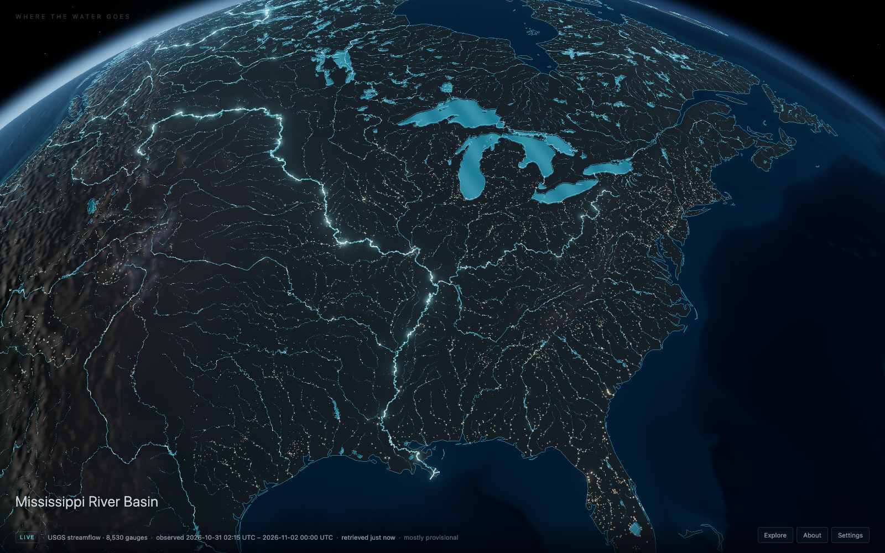
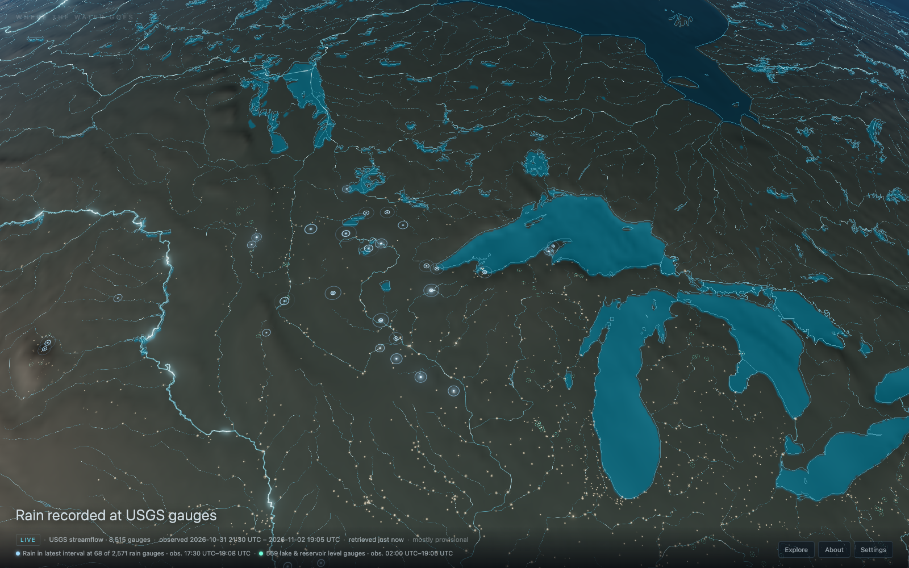

# Where the Water Goes

An open-source screensaver and desktop visualization that turns public U.S. water data into a living globe. It shows rivers, lakes and reservoirs, about 8,500 USGS stream gauges reporting right now, where USGS rain gauges are recording rain, and current lake and reservoir levels. Every value shows where it came from and when.

> **Independent project.** Not affiliated with or endorsed by USGS, NOAA, NASA or any agency.
> **Not a forecast or warning service.** For flood information, use your local National Weather Service office.



## What you see

- **Warm points:** USGS stream gauges (latest discharge). Size is proportional to the log of the published value. A hollow ring means USGS flagged the value as estimated. Most values are provisional.
- **Blue ripples:** USGS rain gauges whose latest reporting interval (usually 5–15 minutes) recorded rain. Dry gauges are not drawn. This is rain measured at points, not a radar map. When enough gauges in one area are recording rain, the tour flies there.

  

- **Teal markers:** USGS lake and reservoir level gauges. All are the same size, because elevation above a datum is not depth. Click one to see its value and datum.
- **Blue lines:** a cartographic river network. The glints move in the *inferred* downstream direction. They do **not** show measured or modeled flow.
- **Terrain and sea floor:** NOAA ETOPO1. **Coastlines, lakes, rivers:** Natural Earth.
- The status line always separates **mode** (Live / Cached / *Archived snapshot · not live*), **observation time** and **retrieval time**.

## Run it

Requirements: Node ≥ 22.18. Rust (via rustup) is needed only for the desktop app.

```sh
npm install
npm run dev            # browser at http://localhost:5173
npm test               # unit tests (Vitest)
npm run tauri dev      # desktop app
npm run tauri build    # release bundle for this OS
```

Desktop launch modes (see [docs/PLATFORMS.md](docs/PLATFORMS.md)):

```sh
"Where the Water Goes" --saver       # fullscreen on every monitor, exits on input
"Where the Water Goes" --idle 10     # tray; starts the saver after 10 idle minutes
```

**Keys:** `T` tour/explore · `I` about and data sources · `S` settings · `Esc` close.
In explore mode, drag to rotate, scroll to zoom, and click a gauge for details.

## Platform status (v0.1)

| | App | Idle fullscreen | Native screensaver |
|---|---|---|---|
| macOS | ✅ built and run | ✅ saver windows run; idle trigger untested by hand | ❌ needs a separate Swift `.saver` (not built) |
| Windows | CI build, untested | implemented, untested | `.scr` via `scripts/make-scr.mjs`; `/p` preview is a static thumbnail (untested) |
| Linux | CI build, untested | X11 implemented, untested; Wayland partial | ❌ |

## Rebuilding the bundled data

```sh
node scripts/fetch-basemap-sources.mjs .data-raw
node scripts/build-basemap.mjs .data-raw        # → public/data/base + manifest.json (hashes, provenance)
node scripts/build-demo-snapshot.ts             # → public/data/demo/usgs-snapshot.json (real, archived)
```

## Documentation

- [Investigation and plan](docs/PLAN.md)
- [Architecture](docs/ARCHITECTURE.md)
- [Data sources](docs/DATA_SOURCES.md)
- [Platforms and screensaver status](docs/PLATFORMS.md)
- [Volunteer computing (why it's off)](docs/VOLUNTEER_COMPUTING.md)
- [Privacy](docs/PRIVACY.md)
- [Licensing](docs/LICENSING.md)
- [Research partner brief](docs/RESEARCH_PARTNER_BRIEF.md)
- [Contributing](CONTRIBUTING.md)
- [Security](SECURITY.md)

## License

Code: Apache-2.0 (see [LICENSE](LICENSE) and [NOTICE](NOTICE)). Data credits are in [NOTICE](NOTICE).
